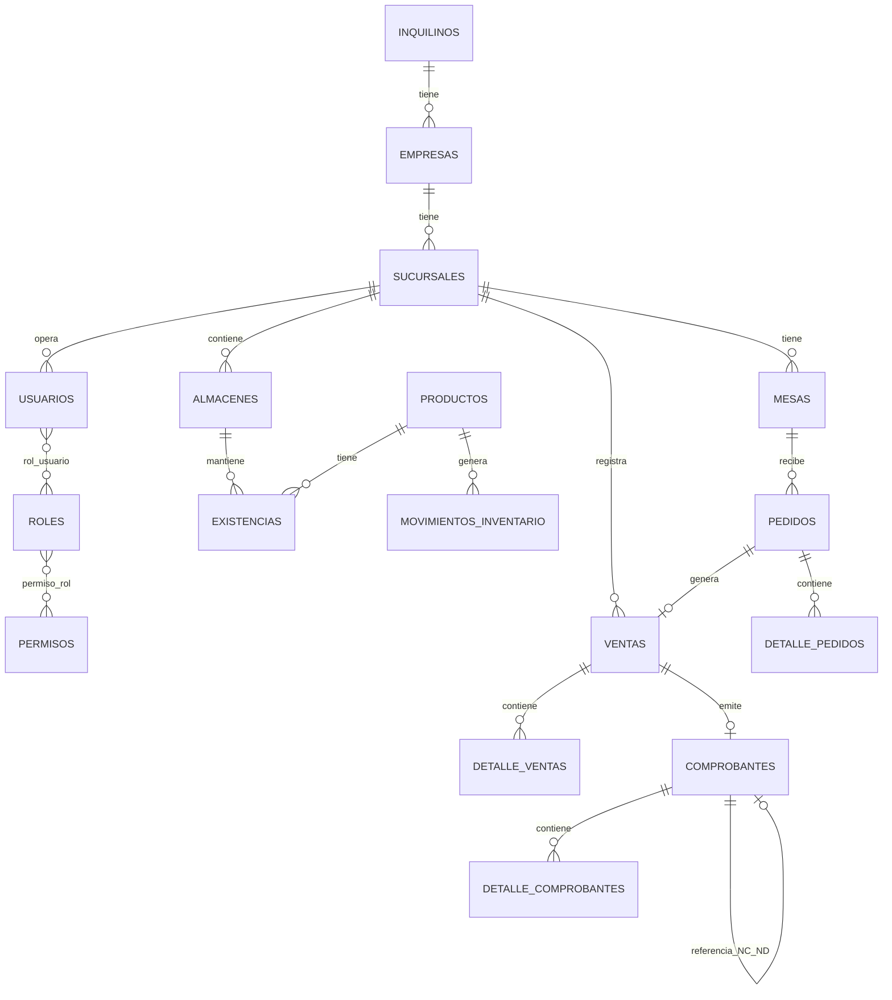

# Especificación Técnica — SaaS Facturación Softflyer
## Documento N.° 02 — Modelo de Datos Maestro (nomenclatura en español)

**Proyecto:** SaaS Facturación Softflyer
**Estado:** Diseño de Datos
**Depende de:** Documento N.° 01 — Arquitectura General, decisiones sobre aislamiento multi-tenant (RLS), envío asíncrono a SUNAT y certificados por empresa.

**Nota sobre este cambio:** se mantiene exactamente el mismo modelo y las mismas reglas del documento anterior; lo único que cambia es que todas las tablas y columnas ahora están en español, para que el equipo pueda leer el esquema sin traducir mentalmente cada nombre. Es una convención válida y común en proyectos peruanos/latinoamericanos; lo importante es aplicarla de forma consistente en todo el sistema, cosa que se respeta aquí.

---

## 1. Objetivo de este documento

Definir el modelo de datos del Núcleo (independiente de rubro) y del primer módulo vertical (Restaurante), de forma que:

- Toda tabla con datos de negocio quede aislada por empresa/inquilino desde el diseño.
- Las reglas de integridad y los catálogos SUNAT queden fijados antes de escribir migraciones.
- Cualquier módulo nuevo (Farmacia, Hotel, etc.) reutilice las mismas tablas del Núcleo sin modificarlas.

---

## 2. Convenciones de nomenclatura (en español)

| Elemento | Convención | Ejemplo |
|---|---|---|
| Tablas | plural, `snake_case` en español | `productos`, `ventas` |
| Tablas pivote | ambas entidades en singular, unidas por guion bajo | `rol_usuario`, `permiso_rol` |
| Llave primaria | `id` (numérico, autoincremental) | `id` |
| Llave foránea | `{entidad_singular}_id` | `inquilino_id`, `almacen_id` |
| Multi-tenant | toda tabla de negocio incluye `inquilino_id` | `inquilino_id` |
| Fechas de sistema | `creado_en`, `actualizado_en` | — |
| Borrado lógico | `eliminado_en` (nulo si no se ha borrado) | — |
| Auditoría de usuario | `creado_por`, `actualizado_por` (FK a `usuarios`, opcional) | — |
| Booleanos | prefijo `es_` / `tiene_` | `es_activo`, `tiene_igv` |
| Montos | `DECIMAL(12,2)`, nunca `FLOAT` | `monto_total` |
| Estados | columna `estado` en texto legible, nunca códigos numéricos sin catálogo | `estado = 'ACEPTADO'` |

**Regla transversal:** ninguna tabla de negocio se crea sin `inquilino_id` y sin su política de aislamiento (RLS) correspondiente en la misma migración (ver sección 8).

---

## 3. Jerarquía organizacional (Núcleo)

```
inquilinos
  └── empresas
        └── sucursales
              └── usuarios (a través de sucursal_usuario)
usuarios → roles → permisos
```

### 3.1 `inquilinos`
| Columna | Tipo | Notas |
|---|---|---|
| id | BIGINT PK | |
| nombre | VARCHAR | Nombre comercial de la cuenta SaaS |
| estado | VARCHAR | `ACTIVO`, `SUSPENDIDO`, `MOROSO` |
| plan_id | BIGINT FK → `planes` | |
| creado_en / actualizado_en | | |

### 3.2 `empresas` (razones sociales dentro de un inquilino)

Un inquilino puede tener más de una empresa legal (RUC distinto) — por ejemplo, un grupo económico con dos razones sociales operando en la misma cuenta.

| Columna | Tipo | Notas |
|---|---|---|
| id | BIGINT PK | |
| inquilino_id | BIGINT FK | |
| razon_social | VARCHAR | |
| ruc | VARCHAR(11) | Único por inquilino, validado con dígito verificador |
| direccion_fiscal | VARCHAR | Requerida por SUNAT en el XML |
| certificado_digital_id | BIGINT FK → `certificados_digitales` | Almacenamiento cifrado (ver Doc. 01) |
| usuario_sol / clave_sol_cifrada | VARCHAR | Credenciales SOL, cifradas en reposo |

### 3.3 `sucursales`
| Columna | Tipo | Notas |
|---|---|---|
| id | BIGINT PK | |
| empresa_id | BIGINT FK | |
| nombre | VARCHAR | |
| codigo_ubigeo | VARCHAR(6) FK → `ubigeos` | Requerido por SUNAT |
| es_principal | BOOLEAN | |

Las series de comprobantes (sección 6.3) cuelgan de `sucursales`, no de `empresas`, porque SUNAT numera por punto de emisión.

### 3.4 IAM: `usuarios`, `roles`, `permisos`
| Tabla | Notas |
|---|---|
| `usuarios` | `inquilino_id`, `correo` único por inquilino (no global), `contrasena`, `es_activo` |
| `roles` | `inquilino_id` opcional: si es nulo, es un rol de plantilla del sistema (`Administrador`, `Cajero`, `Mozo`); si tiene valor, es un rol personalizado de ese inquilino |
| `permisos` | catálogo global del sistema (ej. `ventas.crear`, `caja.cerrar`) |
| `rol_usuario` | pivote: `inquilino_id`, `rol_id`, `usuario_id`, `sucursal_id` opcional (permite roles distintos por sucursal) |
| `permiso_rol` | pivote: `rol_id`, `permiso_id` |

---

## 4. Catálogos SUNAT (globales, sin `inquilino_id`)

Se pueblan mediante *seeders* versionados, no editables a mano en producción, porque SUNAT los actualiza periódicamente.

| Catálogo | Uso | Ejemplo |
|---|---|---|
| `tipos_documento` | Documento de identidad | DNI, RUC, Carné de Extranjería, Pasaporte |
| `tipos_comprobante` | Tipo de comprobante | Boleta (03), Factura (01), Nota de Crédito (07), Nota de Débito (08) |
| `monedas` | Moneda | PEN, USD |
| `unidades_medida` | Catálogo 03 SUNAT | NIU (unidad), KGM (kg), ZZ (servicio) |
| `impuestos` | Impuestos | IGV 18%, Exonerado, Inafecto |
| `motivos_nota_credito` / `motivos_nota_debito` | Motivos NC/ND | Anulación, Descuento, Devolución |
| `ubigeos` | Ubicación geográfica INEI | Departamento / Provincia / Distrito |

---

## 5. Productos e inventario (Núcleo, reutilizado por todos los módulos)

### 5.1 `productos`
| Columna | Tipo | Notas |
|---|---|---|
| id | BIGINT PK | |
| inquilino_id | BIGINT FK | |
| categoria_id | BIGINT FK → `categorias` | |
| marca_id | BIGINT FK → `marcas`, opcional | |
| unidad_medida_id | BIGINT FK → catálogo SUNAT | |
| sku | VARCHAR | Único por inquilino |
| nombre | VARCHAR | |
| precio_venta | DECIMAL(12,2) | |
| tiene_igv | BOOLEAN | |
| controla_lotes | BOOLEAN | Para que Farmacia (lotes/vencimiento) reutilice esta misma tabla en vez de crear una paralela |
| controla_series | BOOLEAN | Para módulos que requieran número de serie por unidad |
| es_activo | BOOLEAN | |

`categorias`, `marcas`: tablas simples con `inquilino_id`, `nombre`.

### 5.2 Inventario físico

| Tabla | Notas |
|---|---|
| `almacenes` | `inquilino_id`, `sucursal_id` (un almacén pertenece a una sucursal) |
| `existencias` | `producto_id`, `almacen_id`, `cantidad` — saldo actual, se actualiza por eventos, nunca calculado en tiempo real sumando el kardex |
| `movimientos_inventario` (Kardex) | `producto_id`, `almacen_id`, `tipo` (`ENTRADA`/`SALIDA`/`AJUSTE`/`TRASLADO`), `cantidad`, `referencia_tipo`, `referencia_id` (polimórfico: venta, compra o traslado que originó el movimiento) |
| `traslados_almacen` | `almacen_origen_id`, `almacen_destino_id`, `estado` |
| `lotes_producto` | Usado por Farmacia: `producto_id`, `numero_lote`, `fecha_vencimiento`, `cantidad` |

**Regla de integridad clave:** `existencias.cantidad` es una tabla *derivada* del Kardex (`movimientos_inventario`), no la fuente de verdad. Ningún controlador actualiza `existencias` directamente; todo cambio de stock pasa primero por un registro en `movimientos_inventario`. Esto permite auditar cualquier descuadre de inventario después.

---

## 6. Ventas, comprobantes y facturación electrónica

### 6.1 `clientes` / `proveedores`

Ambas con `inquilino_id`, `tipo_documento_id` (FK a catálogo), `numero_documento`, `nombre`, `direccion`. Se mantienen separadas (no una tabla genérica "contactos") porque un cliente y un proveedor tienen atributos y validaciones distintas (ej. línea de crédito solo aplica a cliente), y mezclarlos obligaría a nulos condicionales en casi todas las columnas.

### 6.2 `ventas` (cabecera) y `detalle_ventas`

| `ventas` | Notas |
|---|---|
| inquilino_id, sucursal_id, cliente_id | |
| usuario_id | Vendedor o cajero |
| subtotal, monto_impuesto, monto_total | DECIMAL(12,2) |
| estado | `BORRADOR`, `EMITIDA`, `ANULADA` |
| comprobante_id | FK opcional → `comprobantes` (una venta puede generar el comprobante después, no siempre en el mismo instante — relevante en Restaurante, donde el pedido existe antes del cobro) |

`detalle_ventas`: `venta_id`, `producto_id`, `cantidad`, `precio_unitario`, `descuento`, `monto_impuesto`.

### 6.3 `comprobantes` — núcleo de la facturación electrónica

| Columna | Tipo | Notas |
|---|---|---|
| id | BIGINT PK | |
| inquilino_id, empresa_id, sucursal_id | | |
| tipo_comprobante_id | FK catálogo | Boleta / Factura / NC / ND |
| serie | VARCHAR | Por sucursal + tipo de comprobante |
| correlativo | BIGINT | Único por (`sucursal_id`, `tipo_comprobante_id`, `serie`) |
| cliente_id | FK | |
| fecha_emision | DATE | |
| moneda_id | FK catálogo | |
| subtotal, monto_impuesto, monto_total | DECIMAL(12,2) | |
| estado_sunat | VARCHAR | `PENDIENTE_ENVIO`, `ENVIADO`, `ACEPTADO`, `RECHAZADO`, `OBSERVADO` — flujo asíncrono definido en el Doc. 01 |
| codigo_respuesta_sunat | VARCHAR opcional | |
| ruta_xml / ruta_cdr / ruta_pdf | VARCHAR opcional | Ubicación de archivos generados (almacenamiento, no en la BD) |
| enviado_en / aceptado_en | TIMESTAMP opcional | |
| comprobante_relacionado_id | BIGINT FK opcional → `comprobantes` | Para NC/ND, referencia al comprobante que modifican |
| motivo_nota_credito_id / motivo_nota_debito_id | FK opcional | Solo aplica a NC/ND |

**Restricción obligatoria:** `UNIQUE (sucursal_id, tipo_comprobante_id, serie, correlativo)`. Sin este índice único es posible emitir dos comprobantes con el mismo número, algo que SUNAT rechaza y que además es ilegal.

`detalle_comprobantes`: detalle del comprobante, estructura similar a `detalle_ventas` pero es una copia congelada al momento de emisión (no se recalcula si el producto cambia de precio después).

### 6.4 Compras
`compras` y `detalle_compras`: estructura simétrica a ventas, con `proveedor_id` en vez de `cliente_id`. Reutilizan `movimientos_inventario` para registrar el ingreso de mercadería.

### 6.5 Caja
| Tabla | Notas |
|---|---|
| `cajas` | Cajas físicas o virtuales por sucursal |
| `sesiones_caja` | Apertura/cierre: `monto_apertura`, `monto_cierre`, `abierta_por`, `cerrada_por`, `estado` (`ABIERTA`/`CERRADA`) |
| `movimientos_caja` | Ingresos/egresos dentro de una sesión: `tipo`, `monto`, `referencia_tipo`, `referencia_id` (polimórfico, igual que el Kardex) |
| `pagos` | `metodo_pago_id` (catálogo), `venta_id` o `comprobante_id`, `monto` |

---

## 7. Entidades del módulo Restaurante

Tablas propias del módulo, que referencian entidades del Núcleo (`ventas`, `productos`, `sucursales`) sin que el Núcleo dependa de ellas.

| Tabla | Notas |
|---|---|
| `salones` | `sucursal_id`, `nombre` |
| `mesas` | `salon_id`, `codigo`, `capacidad`, `estado` (`LIBRE`/`OCUPADA`/`RESERVADA`) |
| `pedidos` | `mesa_id` opcional (nulo para delivery/para llevar), `mozo_id` (FK → `usuarios`), `estado`, `venta_id` FK opcional — el pedido se cierra generando una venta, no al revés |
| `detalle_pedidos` (comandas) | `pedido_id`, `producto_id`, `cantidad`, `notas`, `estado_cocina` (`PENDIENTE`/`EN_PREPARACION`/`LISTO`/`ENTREGADO`) |
| `reservas` | `mesa_id`, `cliente_id`, `reservado_para`, `estado` |
| `entregas` (delivery) | `pedido_id`, `direccion`, `repartidor_id`, `estado` |

**Distinción importante:** un `pedido` no es lo mismo que una `venta`. El pedido nace en la mesa y puede modificarse varias veces mientras el cliente consume; solo al momento del cobro se genera la venta y, eventualmente, el comprobante. Modelarlos como la misma entidad obligaría a que cada plato agregado disparara el flujo de facturación, algo que no tiene sentido operativo.

---

## 8. Aislamiento Multi-Tenant a nivel de base de datos (RLS)

Cada tabla de negocio (todas las anteriores, excepto los catálogos SUNAT y `permisos`) se crea junto con su política de aislamiento. Plantilla estándar por tabla:

```sql
ALTER TABLE productos ENABLE ROW LEVEL SECURITY;

CREATE POLICY aislamiento_inquilino_productos ON productos
    USING (inquilino_id = current_setting('app.inquilino_actual')::bigint);
```

La aplicación, al iniciar cada solicitud autenticada, ejecuta:

```sql
SET app.inquilino_actual = '<id_del_inquilino_del_usuario_autenticado>';
```

mediante un middleware de Laravel que corre **antes** de cualquier consulta de negocio. Esto convierte el aislamiento de "convención de código" a "regla de base de datos": incluso una consulta manual desde `psql`, sin pasar por Laravel, respeta el aislamiento si no se fija ese parámetro de sesión.

---

## 9. Auditoría

Tabla única `bitacora_auditoria`: `inquilino_id`, `usuario_id`, `accion` (`CREADO`/`ACTUALIZADO`/`ELIMINADO`), `entidad_tipo`, `entidad_id` (polimórfico), `valores_anteriores` (JSONB), `valores_nuevos` (JSONB), `creado_en`.

Se usa JSONB en vez de columnas fijas porque el conjunto de campos auditables varía por entidad; una tabla con una columna por cada posible campo del sistema no escala.

---

## 10. Reglas de integridad transversales

- Toda llave foránea usa `ON DELETE RESTRICT` por defecto (no se permite borrar un cliente con ventas asociadas). `ON DELETE CASCADE` solo en relaciones de composición estricta (ej. `detalle_ventas` cuando se borra `ventas`, algo que en la práctica no ocurre porque las ventas emitidas no se eliminan, solo se anulan).
- Ningún comprobante se borra físicamente: solo borrado lógico + cambio de estado a `ANULADA`, porque SUNAT exige trazabilidad completa de lo emitido, incluso lo anulado.
- Montos siempre `DECIMAL(12,2)`, nunca `FLOAT`, para evitar errores de redondeo en cálculos tributarios.
- `CHECK (monto_total = subtotal + monto_impuesto)` a nivel de base de datos en `ventas` y `comprobantes`, no solo validado en el backend.

---

## 11. Índices recomendados

- Índice compuesto `(inquilino_id, creado_en)` en las tablas de mayor volumen (`ventas`, `comprobantes`, `movimientos_inventario`), por ser la consulta más frecuente en reportes por rango de fechas.
- Índice único ya mencionado en `comprobantes (sucursal_id, tipo_comprobante_id, serie, correlativo)`.
- Índice `(producto_id, almacen_id)` en `existencias` y `movimientos_inventario`.

---

## 12. Diagrama entidad-relación (nivel conceptual)



---

## 13. Estrategia de migraciones (Laravel)

Orden obligatorio, porque cada bloque depende del anterior:

1. Catálogos SUNAT (sin dependencias, sin `inquilino_id`).
2. `inquilinos` → `empresas` → `sucursales`.
3. IAM: `usuarios`, `roles`, `permisos` y pivotes.
4. Productos: `categorias`, `marcas`, `productos`.
5. Inventario: `almacenes`, `existencias`, `movimientos_inventario`, `traslados_almacen`.
6. Comercial: `clientes`, `proveedores`, `ventas`, `detalle_ventas`, `compras`, `detalle_compras`.
7. Facturación: `comprobantes`, `detalle_comprobantes`.
8. Caja: `cajas`, `sesiones_caja`, `movimientos_caja`, `pagos`.
9. Auditoría: `bitacora_auditoria`.
10. Módulo Restaurante: `salones`, `mesas`, `pedidos`, `detalle_pedidos`, `reservas`, `entregas`.

Cada migración de una tabla de negocio incluye, en el mismo archivo, la política RLS correspondiente (sección 8), no como tarea pendiente para después.

---

## 14. Nota técnica sobre nombrar en español dentro de Laravel

Un detalle práctico que conviene dejar anotado: Laravel/Eloquent asume por convención nombres en inglés en algunos lugares (por ejemplo, `created_at`/`updated_at` los gestiona el framework automáticamente; si se usa `creado_en`/`actualizado_en`, hay que declararlo explícitamente en cada modelo con `const CREATED_AT = 'creado_en';` y `const UPDATED_AT = 'actualizado_en';`). Esto no es un problema, pero si no se declara desde el primer modelo, algunos desarrolladores volverán por costumbre a los nombres en inglés a mitad de proyecto y el esquema quedará mezclado. Vale la pena definir una clase base `ModeloBase` que ya traiga esta configuración, para que ningún modelo nuevo tenga que repetirla.

---

## 15. Próximo documento

Con este modelo aprobado (ya en español), el siguiente paso lógico es el **Documento N.° 03 — Arquitectura Multi-Tenant y Aprovisionamiento**, que detalla el ciclo de vida completo de un inquilino (alta, planes, suspensión por mora, baja) y los procedimientos operativos de RLS (pruebas automatizadas que verifiquen que ningún inquilino puede leer datos de otro).
