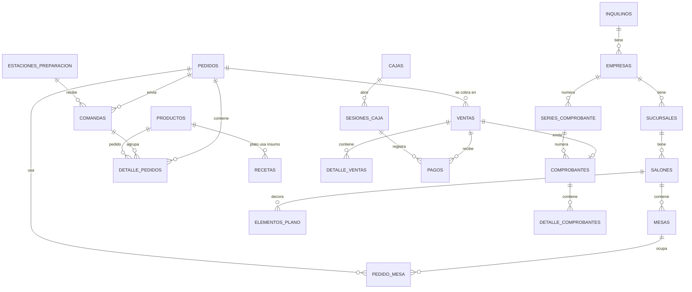

# Especificación Técnica — SaaS Facturación Softflyer
## Documento N.° 08 — Modelo de Datos Normalizado: Restaurante + Facturación Electrónica (Fase 1)

**Proyecto:** SaaS Facturación Softflyer
**Estado:** Diseño de Datos — listo para migraciones
**Depende de:** Doc. 02 (convenciones, RLS), Doc. 03 (inquilinos y planes), Doc. 04 (Greenter), Doc. 05 (módulo Restaurante), Doc. 06 (IAM)
**Reemplaza:** las definiciones de tablas de los Doc. 02 y 05 donde este documento diga algo distinto. Las convenciones de nombres del Doc. 02 §2 siguen vigentes.

> Nota de numeración: el índice del Doc. 07 reservaba el N.° 08 para Infraestructura y DevOps. Ese documento pasa a ser el N.° 09.

---

## 1. Alcance

Softflyer se enfoca, por ahora, en **un solo rubro: restaurantes**. El cliente debe poder manejar su local completo desde el sistema:

| Necesidad del restaurante | Dónde vive en el modelo |
|---|---|
| Armar su plano de salón arrastrando mesas, barra y paredes desde una barra de herramientas | §7 Salón y plano |
| Mozos/meseras toman pedidos y cocina los recibe en tiempo real (WebSocket) | §8 Pedidos y comandas |
| Carta con modificadores ("término medio", "extra queso") | §5 Carta |
| Inventario de insumos que se descuenta solo al vender un plato | §6 Inventario y recetas |
| Caja con apertura, cierre y arqueo | §10 Caja |
| Boletas y facturas electrónicas SUNAT | §11 Facturación |
| Roles: administrador, cajero, mozo, cocinero | §4 IAM |

Quedan **fuera de la Fase 1** (se diseñan cuando se aborden): reservas, delivery propio y de plataformas, combos, precios por sucursal, traslados entre almacenes, lotes y vencimientos, marcas.

---

## 2. Reglas de normalización aplicadas

El modelo está en **tercera forma normal (3FN)**. Cada excepción es deliberada y está listada aquí; cualquier otra redundancia es un error de diseño.

| Excepción | Por qué se acepta |
|---|---|
| `inquilino_id` repetido en tablas hijas (ej. `detalle_pedidos`) | RLS evalúa cada fila sin joins. Se protege con **FK compuestas** (§2.1) para que nunca contradiga al padre. |
| Copias congeladas en `detalle_pedidos`, `detalle_ventas`, `comprobantes`, `detalle_comprobantes` (precio, descripción, datos del cliente) | Un documento ya emitido no puede cambiar si mañana cambia el precio del plato o la dirección del cliente. Es una obligación legal, no redundancia. |
| `existencias.cantidad` y `existencias.costo_promedio` | Saldo derivado del kardex (`movimientos_inventario`), guardado para no sumar millones de filas en cada venta. Solo lo actualiza el servicio de inventario, en la misma transacción que el movimiento. |
| `mesas.estado` | Estado derivado de los pedidos abiertos, guardado para pintar el plano al instante. Se actualiza en la misma transacción que el pedido. |
| `sesiones_caja.monto_cierre_calculado` | Foto del arqueo al momento del cierre, para auditoría; no se recalcula. |

### 2.1 FK compuestas contra fugas entre inquilinos

RLS impide **leer** filas de otro inquilino, pero no impide que una fila propia **apunte** al `id` de una fila ajena si alguien conoce ese número. Por eso:

- Toda tabla con `inquilino_id` declara además `UNIQUE (inquilino_id, id)`.
- Toda FK hacia una tabla multi-inquilino es compuesta: `FOREIGN KEY (inquilino_id, pedido_id) REFERENCES pedidos (inquilino_id, id)`.

Así PostgreSQL garantiza que el hijo y el padre pertenecen al mismo inquilino.

### 2.2 Estados y catálogos

- **Máquinas de estado** (`pedidos.estado`, `mesas.estado`, etc.): `VARCHAR` + `CHECK (estado IN (...))`. Son pocas, fijas y las define el código.
- **Catálogos SUNAT y de negocio** (tipos de documento, métodos de pago, etc.): tablas propias, porque SUNAT los cambia y se versionan con seeders.

### 2.3 Convenciones de columnas (recordatorio)

`id BIGINT` · `inquilino_id` · `creado_en` / `actualizado_en` (timestamptz) · `eliminado_en` para borrado lógico · montos `NUMERIC(12,2)` · cantidades de inventario `NUMERIC(14,4)` · booleanos `es_` / `tiene_`.

---

## 3. Mapa general

58 tablas en 12 bloques. **✅ = ya existe en la BD.**

| # | Bloque | Tablas | RLS | Contexto de código |
|---|---|---|---|---|
| A | Catálogos globales | `tipos_documento_identidad`, `tipos_comprobante`, `monedas`, `unidades_medida`, `tipos_afectacion_igv`, `tasas_igv`, `motivos_nota_credito`, `motivos_nota_debito`, `ubigeos`, `metodos_pago` | No | `Core/Billing` |
| B | SaaS | `inquilinos` ✅, `planes`, `suscripciones`, `uso_inquilino` | Parcial* | `Core/Tenancy` |
| C | Organización | `empresas`, `sucursales`, `certificados_digitales`, `series_comprobante` | Sí | `Core/Tenancy`, `Core/Billing` |
| D | IAM | `usuarios` ✅, `roles`, `permisos`, `rol_usuario`, `permiso_rol` | Sí** | `Core/Iam` |
| E | Carta | `categorias`, `productos`, `estaciones_preparacion`, `modificador_grupos`, `modificadores`, `producto_modificador_grupo` | Sí | `Core/Inventory`, `Modules/Restaurant` |
| F | Inventario y compras | `almacenes`, `existencias`, `movimientos_inventario`, `recetas`, `proveedores`, `compras`, `detalle_compras` | Sí | `Core/Inventory`, `Modules/Restaurant` |
| G | Salón y plano | `salones`, `mesas`, `elementos_plano` | Sí | `Modules/Restaurant` |
| H | Pedidos | `pedidos`, `pedido_mesa`, `comandas`, `detalle_pedidos`, `detalle_pedido_modificador` | Sí | `Modules/Restaurant` |
| I | Venta y cobro | `clientes`, `ventas`, `detalle_ventas`, `venta_detalle_pedido`, `pagos` | Sí | `Core/Sales`, `Modules/Restaurant` |
| J | Caja | `cajas`, `sesiones_caja`, `movimientos_caja` | Sí | `Core/Cash` |
| K | Facturación | `comprobantes`, `detalle_comprobantes`, `resumenes_sunat`, `resumen_sunat_comprobantes` | Sí | `Core/Billing` |
| L | Transversal | `bitacora_auditoria`, `claves_idempotencia` | Sí | `Shared` / `Core/Iam` |

\* `inquilinos` y `planes` no llevan RLS (`inquilinos` se consulta antes de conocer al inquilino; `planes` es global). `suscripciones` y `uso_inquilino` sí.
\*\* `permisos` es un catálogo global sin RLS; `roles` admite `inquilino_id` nulo para las plantillas del sistema (§4).



---

## 4. IAM para restaurante (bloque D)

Se elimina `sucursal_usuario` del diagrama del Doc. 02: **`rol_usuario.sucursal_id` ya expresa en qué sucursal trabaja cada usuario**, y tener las dos tablas permitiría que se contradigan.

### `usuarios` ✅ (se agregan columnas)
| Columna | Tipo | Notas |
|---|---|---|
| pin_hash | VARCHAR null | PIN de 4–6 dígitos para que el mozo cambie de usuario rápido en una tablet compartida. Hash igual que la contraseña. |

### `roles`
| Columna | Tipo | Notas |
|---|---|---|
| inquilino_id | BIGINT null | Nulo = plantilla del sistema |
| nombre | VARCHAR | Único por inquilino |
| es_sistema | BOOLEAN | Las plantillas clonadas no se pueden borrar, solo editar sus permisos |

### `permisos` (global), `permiso_rol`, `rol_usuario`
- `permisos`: `codigo` único (`restaurante.pedidos.crear`, catálogo del Doc. 06 §5), `descripcion`, `modulo`.
- `permiso_rol`: PK `(rol_id, permiso_id)`.
- `rol_usuario`: `inquilino_id`, `usuario_id`, `rol_id`, `sucursal_id` null (null = todas las sucursales). `UNIQUE (usuario_id, rol_id, sucursal_id)`.

### Plantillas de rol del rubro

| Rol | Puede | No puede |
|---|---|---|
| Administrador | Todo, incluido configurar empresa y certificado | — |
| Cajero | Abrir/cerrar caja, cobrar, dividir cuenta, emitir y anular comprobantes | Editar carta, ver reportes financieros |
| Mozo | Ver plano, abrir/editar pedidos, enviar comandas, pedir cuenta | Cobrar, ver caja |
| Cocinero | Ver KDS de su estación, cambiar estado de cocina | Ver precios ni clientes |
| Encargado de salón | Todo lo del mozo + editar el plano, unir mesas, anular ítems ya enviados | Caja y facturación |

---

## 5. Carta (bloque E)

🔧 Cambio respecto al Doc. 05 §3.5: los modificadores se agrupan. En un restaurante real se elige **uno** de un grupo ("Término: azul / medio / tres cuartos / bien cocido") o **varios** de otro ("Extras: queso, tocino, huevo"). Con `modificadores.producto_id` suelto no se puede exigir "elige exactamente uno", y el mismo grupo ("Término") se repetiría para cada carne de la carta.

### `estaciones_preparacion`
A dónde va cada plato: Cocina, Bar, Parrilla, Postres. Cada estación tiene su propia pantalla KDS y/o impresora.
| Columna | Tipo | Notas |
|---|---|---|
| inquilino_id | BIGINT | |
| nombre | VARCHAR | Único por inquilino |
| es_activa | BOOLEAN | |

### `categorias`
| Columna | Tipo | Notas |
|---|---|---|
| inquilino_id | BIGINT | |
| nombre | VARCHAR | "Entradas", "Fondos", "Bebidas" |
| estacion_preparacion_id | BIGINT null | Estación por defecto de sus productos |
| color | CHAR(7) null | Color del botón en el POS |
| orden | INT | Orden en el POS |
| es_activa | BOOLEAN | |

### `productos`
Un solo catálogo para lo que se vende y lo que se compra.
| Columna | Tipo | Notas |
|---|---|---|
| inquilino_id, categoria_id | BIGINT | |
| tipo | VARCHAR | `PLATO`, `BEBIDA`, `INSUMO` (CHECK) |
| codigo | VARCHAR | Único por inquilino; va al XML como código de producto |
| nombre | VARCHAR | |
| unidad_medida_id | FK catálogo | NIU para platos, KGM/LTR para insumos |
| precio_venta | NUMERIC(12,2) null | **Incluye IGV** (así se publica en la carta). Nulo en insumos. |
| tipo_afectacion_igv_id | FK catálogo | Gravado, exonerado, inafecto |
| estacion_preparacion_id | BIGINT null | Sobrescribe la de la categoría |
| es_vendible | BOOLEAN | `false` en insumos |
| controla_stock | BOOLEAN | `true` en bebidas embotelladas e insumos; los platos descuentan vía receta |
| imagen_ruta | VARCHAR null | |
| es_activo | BOOLEAN | |

### `modificador_grupos`, `modificadores`, `producto_modificador_grupo`
- `modificador_grupos`: `inquilino_id`, `nombre`, `seleccion_minima` (0 = opcional), `seleccion_maxima`. `CHECK (seleccion_minima <= seleccion_maxima)`.
- `modificadores`: `inquilino_id`, `modificador_grupo_id`, `nombre`, `precio_adicional` NUMERIC(12,2) default 0, `es_activo`.
- `producto_modificador_grupo`: PK `(producto_id, modificador_grupo_id)`, `orden`.

---

## 6. Inventario, recetas y compras (bloque F)

### `almacenes`
`inquilino_id`, `sucursal_id`, `nombre`, `es_principal`. Normalmente uno por local ("Almacén" o "Cocina").

### `recetas` — el corazón del inventario de un restaurante
Qué insumos consume **una unidad** de un plato.
| Columna | Tipo | Notas |
|---|---|---|
| inquilino_id | BIGINT | |
| producto_id | BIGINT | El plato |
| insumo_id | BIGINT | Un producto con `tipo = 'INSUMO'` |
| cantidad | NUMERIC(14,4) | En la unidad de medida del insumo (ej. 0.2500 KGM de lomo) |

`UNIQUE (producto_id, insumo_id)` · `CHECK (producto_id <> insumo_id)`.

**Decisión:** el stock se descuenta **al cobrar** (al crear la venta), no al enviar la comanda. Si un plato ya enviado a cocina se anula, se registra como `MERMA`, porque el insumo sí se gastó.

### `existencias` (derivada)
`inquilino_id`, `almacen_id`, `producto_id`, `cantidad`, `costo_promedio`. `UNIQUE (almacen_id, producto_id)`.

### `movimientos_inventario` (kardex, fuente de verdad)
| Columna | Tipo | Notas |
|---|---|---|
| inquilino_id, almacen_id, producto_id | BIGINT | |
| tipo | VARCHAR | `ENTRADA`, `SALIDA`, `AJUSTE`, `MERMA` (CHECK) |
| cantidad | NUMERIC(14,4) | Siempre positiva; el signo lo da `tipo` |
| costo_unitario | NUMERIC(12,4) | |
| referencia_tipo, referencia_id | | Venta, compra o ajuste que lo originó |
| usuario_id | BIGINT | |
| creado_en | timestamptz | Sin `actualizado_en`: el kardex no se edita, se corrige con otro movimiento |

### `proveedores`, `compras`, `detalle_compras`
- `proveedores`: `inquilino_id`, `tipo_documento_identidad_id`, `numero_documento`, `razon_social`, `telefono`, `correo`. `UNIQUE (inquilino_id, tipo_documento_identidad_id, numero_documento)`.
- `compras`: `inquilino_id`, `sucursal_id`, `almacen_id`, `proveedor_id`, `tipo_comprobante_id`, `serie_numero` (del documento del proveedor), `fecha_emision`, `subtotal`, `igv`, `total`, `estado` (`BORRADOR`/`REGISTRADA`/`ANULADA`).
- `detalle_compras`: `compra_id`, `producto_id`, `cantidad`, `costo_unitario`, `total`. Al registrar la compra se generan sus `ENTRADA` en el kardex.

---

## 7. Salón y plano editable (bloque G)

🔧 Nuevo respecto a los Doc. 02 y 05. El cliente arma su plano como en un editor: una barra de herramientas con mesas (cuadrada, redonda, rectangular) y elementos (barra, pared, puerta, columna, planta, baño, caja), que arrastra, redimensiona y rota sobre un lienzo.

**Coordenadas en unidades de lienzo, no en píxeles.** El salón define su tamaño (`ancho` × `alto`, por ejemplo 1000 × 700) y todo se posiciona en esa escala. El frontend escala al tamaño real de la pantalla, así el mismo plano se ve igual en la PC del cajero y en la tablet de la mesera.

### `salones`
| Columna | Tipo | Notas |
|---|---|---|
| inquilino_id, sucursal_id | BIGINT | |
| nombre | VARCHAR | "Salón principal", "Terraza", "2.º piso" |
| ancho, alto | INT | Tamaño del lienzo. CHECK > 0 |
| orden | INT | Orden de las pestañas |
| version | INT | Bloqueo optimista: si dos personas editan el plano a la vez, el segundo en guardar recibe un 409 en vez de pisar al primero |
| es_activo | BOOLEAN | |

### `mesas`
| Columna | Tipo | Notas |
|---|---|---|
| inquilino_id, salon_id | BIGINT | |
| codigo | VARCHAR(10) | "M1", "B3". `UNIQUE (salon_id, codigo)` |
| capacidad | SMALLINT | |
| forma | VARCHAR | `CUADRADA`, `REDONDA`, `RECTANGULAR` (CHECK) |
| pos_x, pos_y | NUMERIC(8,2) | Esquina superior izquierda en el lienzo |
| ancho, alto | NUMERIC(8,2) | |
| rotacion | SMALLINT | 0–359. CHECK |
| estado | VARCHAR | `LIBRE`, `OCUPADA`, `POR_COBRAR`, `BLOQUEADA` (derivado, §2) |
| es_activa | BOOLEAN | Una mesa retirada del plano no se borra si tiene historial |

### `elementos_plano`
Todo lo que se dibuja pero no recibe pedidos.
| Columna | Tipo | Notas |
|---|---|---|
| inquilino_id, salon_id | BIGINT | |
| tipo | VARCHAR | `BARRA`, `PARED`, `PUERTA`, `VENTANA`, `COLUMNA`, `PLANTA`, `BANO`, `CAJA`, `COCINA`, `TEXTO` (CHECK) |
| etiqueta | VARCHAR null | Texto visible ("Barra", "Ingreso") |
| pos_x, pos_y, ancho, alto, rotacion | | Igual que `mesas` |
| capa | SMALLINT | Orden de dibujo (z-index) |

> Se separa de `mesas` (en vez de una sola tabla "elementos" con `tipo = MESA`) porque una mesa tiene capacidad, estado y pedidos, y un muro no. Juntarlas obligaría a columnas nulas condicionales, que es justo lo que la 3FN evita.

---

## 8. Pedidos y comandas en tiempo real (bloque H)

### `pedidos`
| Columna | Tipo | Notas |
|---|---|---|
| inquilino_id, sucursal_id | BIGINT | |
| numero | INT | Correlativo **diario por sucursal**, el que se grita en cocina ("pedido 42") |
| fecha_operacion | DATE | Día del turno al que pertenece. `UNIQUE (sucursal_id, fecha_operacion, numero)` |
| tipo | VARCHAR | `SALON`, `PARA_LLEVAR` (CHECK). `DELIVERY` se agrega en Fase 2 |
| mesa_id | BIGINT null | Mesa principal (Doc. 05 §3.2); nulo si es para llevar |
| mozo_id | BIGINT | FK → `usuarios` |
| cliente_id | BIGINT null | |
| numero_comensales | SMALLINT null | |
| estado | VARCHAR | `ABIERTO`, `POR_COBRAR`, `CERRADO`, `ANULADO` (CHECK) |
| version | INT | Bloqueo optimista: dos meseras agregando platos a la misma mesa a la vez |
| abierto_en, cerrado_en | timestamptz | |

🔧 Simplificación respecto al Doc. 05 §4.2: se quitan `EN_PREPARACION` y `SERVIDO` del estado del pedido. Esos estados ya existen **por plato** en `detalle_pedidos.estado_cocina`; repetirlos en la cabecera es un dato derivado que se desincroniza. El frontend muestra "en preparación" si algún plato lo está.

`CHECK ((tipo = 'SALON') = (mesa_id IS NOT NULL))` — un pedido de salón siempre tiene mesa y uno para llevar nunca.

### `pedido_mesa` (unión de mesas)
`inquilino_id`, `pedido_id`, `mesa_id`, `unida_en`, `liberada_en` null.
`UNIQUE (mesa_id) WHERE liberada_en IS NULL` — **una mesa no puede estar en dos pedidos abiertos a la vez**, garantizado por la BD aunque dos meseras toquen la misma mesa en el mismo segundo.

### `comandas`
🔧 Nuevo. En el Doc. 05, `detalle_pedidos.enviado_a_cocina_en` repetía la misma hora en cada plato enviado junto, y no había forma de reimprimir "la segunda tanda de la mesa 5". Una comanda es **el ticket que viaja a una estación**: los platos que se enviaron juntos a un mismo lugar.
| Columna | Tipo | Notas |
|---|---|---|
| inquilino_id, pedido_id | BIGINT | |
| estacion_preparacion_id | BIGINT | Un envío con platos de cocina y de bar genera **dos** comandas |
| numero | SMALLINT | 1, 2, 3… dentro del pedido. `UNIQUE (pedido_id, estacion_preparacion_id, numero)` |
| enviada_por | BIGINT | |
| enviada_en | timestamptz | |
| impresa_en | timestamptz null | La marca el agente de impresión (Doc. 05 §6) |

### `detalle_pedidos`
| Columna | Tipo | Notas |
|---|---|---|
| inquilino_id, pedido_id | BIGINT | |
| comanda_id | BIGINT null | **Nulo = todavía no se envió a cocina** (la mesera lo puede editar libremente) |
| producto_id | BIGINT | |
| cantidad | NUMERIC(10,3) | |
| precio_unitario | NUMERIC(12,2) | Copia del precio al agregarlo (incluye IGV, sin modificadores) |
| notas | VARCHAR null | Texto libre |
| estado_cocina | VARCHAR | `PENDIENTE`, `EN_PREPARACION`, `LISTO`, `ENTREGADO` (CHECK) |
| anulado_en, anulado_por, motivo_anulacion | null | Un plato ya enviado no se borra: se anula con motivo y queda en auditoría |

### `detalle_pedido_modificador`
PK `(detalle_pedido_id, modificador_id)`, `precio_adicional` (copia congelada).

### Canales en tiempo real (Laravel Reverb)

No son tablas, pero el modelo está pensado para ellos. Todos son canales **privados** y autorizan contra `rol_usuario`:

| Canal | Quién escucha | Eventos |
|---|---|---|
| `sucursal.{id}.salon` | Mozos, cajero | `MesaActualizada`, `PedidoActualizado`, `PlanoActualizado` |
| `sucursal.{id}.estacion.{id}` | KDS e impresora de esa estación | `ComandaEnviada`, `PlatoAnulado` |
| `sucursal.{id}.mozo.{usuario_id}` | La mesera | `PlatoListo` (para recoger en cocina) |

---

## 9. Venta y cobro (bloque I)

### `clientes`
| Columna | Tipo | Notas |
|---|---|---|
| inquilino_id | BIGINT | |
| tipo_documento_identidad_id | FK catálogo | DNI, RUC, CE, pasaporte, o "sin documento" |
| numero_documento | VARCHAR(15) | |
| nombre | VARCHAR | Nombre o razón social |
| direccion, correo, telefono | null | |

`UNIQUE (inquilino_id, tipo_documento_identidad_id, numero_documento)`. Cada inquilino nace con un cliente **"CLIENTES VARIOS"** para boletas sin identificar.

### `ventas`
| Columna | Tipo | Notas |
|---|---|---|
| inquilino_id, sucursal_id | BIGINT | |
| pedido_id | BIGINT null | Doc. 05 §2: un pedido → varias ventas (cuenta dividida) |
| sesion_caja_id | BIGINT | Toda venta pertenece a un turno de caja abierto |
| cliente_id, usuario_id | BIGINT | `usuario_id` = quien cobró |
| op_gravada, op_exonerada, op_inafecta, igv, total | NUMERIC(12,2) | `CHECK (total = op_gravada + op_exonerada + op_inafecta + igv)` |
| monto_propina | NUMERIC(12,2) | Fuera del comprobante (Doc. 05 §7.1) |
| estado | VARCHAR | `EMITIDA`, `ANULADA` (CHECK) |

🔧 Se elimina `ventas.comprobante_id` (Doc. 02 §6.2). La relación vive solo en `comprobantes.venta_id`; tenerla en las dos tablas crea una FK circular y dos fuentes de verdad.

### `detalle_ventas`
`inquilino_id`, `venta_id`, `producto_id`, `descripcion` (copia), `cantidad`, `precio_unitario` (con IGV), `descuento`, `tipo_afectacion_igv_id`, `igv`, `total`.

### `venta_detalle_pedido`
PK `(venta_id, detalle_pedido_id)`. Qué platos del pedido cubrió cada venta (Doc. 05 §2).

### `pagos`
Una venta puede pagarse con varios métodos ("50 en efectivo y el resto con Yape").
| Columna | Tipo | Notas |
|---|---|---|
| inquilino_id, venta_id, sesion_caja_id | BIGINT | |
| metodo_pago_id | FK catálogo | |
| monto | NUMERIC(12,2) | Lo que se aplica a la venta |
| monto_recibido | NUMERIC(12,2) null | Solo efectivo: con cuánto pagó el cliente |
| vuelto | NUMERIC(12,2) | `CHECK (vuelto = COALESCE(monto_recibido, monto) - monto)` |
| referencia | VARCHAR null | N.° de operación Yape/Plin o voucher de tarjeta |

---

## 10. Caja (bloque J)

- `cajas`: `inquilino_id`, `sucursal_id`, `nombre`, `es_activa`.
- `sesiones_caja`: `inquilino_id`, `caja_id`, `abierta_por`, `abierta_en`, `monto_apertura`, `cerrada_por`, `cerrada_en`, `monto_cierre_declarado`, `monto_cierre_calculado`, `estado` (`ABIERTA`/`CERRADA`). `UNIQUE (caja_id) WHERE estado = 'ABIERTA'`: una caja no puede tener dos turnos abiertos.
- `movimientos_caja`: **solo movimientos manuales** — `tipo` (`INGRESO`/`EGRESO`), `monto`, `concepto` ("compra de gas", "retiro para banco"), `usuario_id`.

🔧 Cambio respecto al Doc. 02 §6.5: los cobros **no** se copian a `movimientos_caja`. Ya están en `pagos.sesion_caja_id`; duplicarlos permitiría que el arqueo y las ventas no cuadren. El arqueo se calcula así:

```
efectivo esperado = monto_apertura
                  + SUM(pagos en efectivo de la sesión) − SUM(vueltos)
                  + SUM(ingresos manuales) − SUM(egresos manuales)
```

---

## 11. Facturación electrónica (bloques A, C y K)

### 11.1 Catálogos SUNAT (bloque A, globales, sin RLS)
| Tabla | Catálogo SUNAT | Ejemplos |
|---|---|---|
| `tipos_documento_identidad` | 06 | 1 DNI, 6 RUC, 4 CE, 7 Pasaporte, 0 Sin documento |
| `tipos_comprobante` | 01 | 01 Factura, 03 Boleta, 07 NC, 08 ND |
| `monedas` | 02 | PEN, USD |
| `unidades_medida` | 03 | NIU, KGM, LTR, ZZ |
| `tipos_afectacion_igv` | 07 | 10 Gravado, 20 Exonerado, 30 Inafecto |
| `tasas_igv` | — | `codigo`, `tasa`, `vigente_desde`, `vigente_hasta` |
| `motivos_nota_credito` | 09 | 01 Anulación de la operación, 07 Devolución por ítem |
| `motivos_nota_debito` | 10 | 01 Intereses por mora |
| `ubigeos` | INEI | 150101 Lima / Lima / Lima |
| `metodos_pago` | 59 (+ propios) | Efectivo, Tarjeta, Yape, Plin, Transferencia |

🔧 `impuestos` (Doc. 02 §4) se reemplaza por `tipos_afectacion_igv` + `tasas_igv`. **La tasa de IGV no puede quedar fija en 18 %:** las MYPE del rubro restaurantes tienen una tasa reducida temporal (Ley 31556 y sus prórrogas) que cambia por año. Por eso la tasa tiene vigencia y cada empresa declara si califica (`empresas.aplica_tasa_reducida`). Validar con un contador las tasas vigentes antes de cargar el seeder.

### 11.2 Organización (bloque C)

**`empresas`**: `inquilino_id`, `ruc` CHAR(11), `razon_social`, `nombre_comercial`, `direccion_fiscal`, `ubigeo_id`, `usuario_sol`, `clave_sol_cifrada`, `homologado` BOOLEAN (Doc. 04 §7), `aplica_tasa_reducida` BOOLEAN. `UNIQUE (inquilino_id, ruc)`.

**`sucursales`**: `inquilino_id`, `empresa_id`, `nombre`, `direccion`, `ubigeo_id`, `codigo_establecimiento` CHAR(4) (código de anexo SUNAT, `0000` = domicilio fiscal; va en el XML), `es_principal`.

**`certificados_digitales`**: `inquilino_id`, `empresa_id`, `pem_cifrado`, `formato_origen` (`PFX`/`PEM`), `vence_en`, `es_activo`. `UNIQUE (empresa_id) WHERE es_activo`.
🔧 Dos correcciones: (1) la relación pasa de `empresas.certificado_digital_id` a `certificados_digitales.empresa_id`, para guardar el historial cuando el certificado se renueva cada año; (2) `formato_certificado` se mueve aquí desde `comprobantes` (Doc. 04 §3), porque es un dato del certificado, no de cada boleta.

**`series_comprobante`** — 🔧 faltaba en todos los documentos anteriores.
| Columna | Tipo | Notas |
|---|---|---|
| inquilino_id, empresa_id, sucursal_id | BIGINT | La sucursal que emite con esa serie |
| tipo_comprobante_id | FK catálogo | |
| serie | CHAR(4) | B001, F001, BC01 (NC de boleta)… |
| ultimo_correlativo | BIGINT | Arranca en 0 |
| es_activa | BOOLEAN | |

`UNIQUE (empresa_id, tipo_comprobante_id, serie)` — SUNAT exige series únicas **por RUC**, no por sucursal.
`CHECK (serie ~ '^[BF][A-Z0-9]{3}$')`.

**Cómo se asigna el correlativo sin duplicados:** dentro de la misma transacción que crea el comprobante:
```sql
UPDATE series_comprobante SET ultimo_correlativo = ultimo_correlativo + 1
WHERE id = :serie_id RETURNING ultimo_correlativo;
```
El `UPDATE` bloquea la fila, así que dos cajas cobrando en el mismo segundo reciben números consecutivos, nunca el mismo.

### 11.3 `comprobantes`
| Columna | Tipo | Notas |
|---|---|---|
| inquilino_id, empresa_id | BIGINT | |
| serie_comprobante_id | BIGINT | 🔧 Reemplaza `serie` + `sucursal_id` + `tipo_comprobante_id` sueltos (todo eso se deriva de la serie) |
| correlativo | BIGINT | `UNIQUE (serie_comprobante_id, correlativo)` |
| venta_id | BIGINT null | Nulo en notas de crédito/débito |
| comprobante_relacionado_id | BIGINT null | NC/ND: el comprobante que modifican |
| motivo_nota_credito_id, motivo_nota_debito_id | null | `CHECK` que solo una aplique y solo en NC/ND |
| fecha_emision | DATE | Fecha de Lima (Doc. 07 §7) |
| moneda_id | FK | |
| cliente_id | BIGINT | |
| cliente_tipo_documento, cliente_numero_documento, cliente_nombre, cliente_direccion | | Copia congelada: el comprobante muestra los datos del cliente al momento de emitir |
| op_gravada, op_exonerada, op_inafecta, igv, total | NUMERIC(12,2) | Mismo CHECK que `ventas` |
| estado_sunat | VARCHAR | `PENDIENTE_ENVIO`, `ENVIADO`, `ACEPTADO`, `OBSERVADO`, `RECHAZADO`, `ANULADO` |
| codigo_respuesta_sunat, descripcion_respuesta_sunat | null | |
| hash_cpe | VARCHAR null | Resumen de la firma; va impreso y en el QR |
| ruta_xml, ruta_cdr, ruta_pdf | null | |
| intentos_envio, ultimo_error_tecnico | | Doc. 04 §3 |
| enviado_en, aceptado_en | timestamptz null | |

**Reglas de negocio SUNAT que la API debe validar** (no son columnas, pero dependen de este modelo):
- Factura (01): el cliente debe tener RUC.
- Boleta (03): desde S/ 700 de total, el cliente debe estar identificado (DNI u otro documento).
- La serie debe corresponder al tipo de comprobante (B → boleta, F → factura).

### 11.4 `detalle_comprobantes`
Copia congelada de los ítems: `comprobante_id`, `producto_id`, `codigo`, `descripcion`, `unidad_medida_codigo`, `cantidad`, `valor_unitario` (sin IGV), `precio_unitario` (con IGV), `tipo_afectacion_igv_codigo`, `igv`, `valor_venta`, `total`. SUNAT exige valor y precio por separado.

### 11.5 `resumenes_sunat` y `resumen_sunat_comprobantes`
🔧 Faltaban. SUNAT no anula una boleta ni una factura con un simple cambio de estado:
- **Anular una factura** → se envía una **Comunicación de Baja**.
- **Anular una boleta** (y, opcionalmente, informar boletas del día) → se envía un **Resumen Diario**.

Ambos son envíos **en lote** que SUNAT responde con un *ticket* que se consulta después.

`resumenes_sunat`: `inquilino_id`, `empresa_id`, `tipo` (`RESUMEN_DIARIO`/`COMUNICACION_BAJA`), `fecha_referencia`, `correlativo` (del día), `ticket`, `estado` (`PENDIENTE`/`ENVIADO`/`ACEPTADO`/`RECHAZADO`), `ruta_xml`, `ruta_cdr`, `enviado_en`.
`resumen_sunat_comprobantes`: PK `(resumen_sunat_id, comprobante_id)`, `accion` (`ADICIONAR`/`ANULAR`).

---

## 12. Transversal (bloque L)
- `bitacora_auditoria` (Doc. 02 §9) — eventos obligatorios del rubro, además de los de IAM: anulación de plato enviado a cocina, anulación de venta o comprobante, cierre de caja con diferencia, cambio de precio en la carta.
- `claves_idempotencia` (Doc. 07 §5) — se agrega `POST /pedidos/{id}/comandas` a los endpoints que la exigen: si la tablet pierde señal al enviar, la cocina no debe recibir la comanda dos veces.

---

## 13. Orden de migraciones

Cada lote depende del anterior; cada tabla con `inquilino_id` trae su RLS en la misma migración.

| Lote | Tablas | Desbloquea |
|---|---|---|
| 1 | Catálogos A + `planes`, `suscripciones`, `uso_inquilino` | — |
| 2 | `empresas`, `sucursales`, `certificados_digitales`, `series_comprobante` | Datos fiscales |
| 3 | `roles`, `permisos`, `rol_usuario`, `permiso_rol` (+ `usuarios.pin_hash`) | Roles en el login |
| 4 | `estaciones_preparacion`, `categorias`, `productos`, modificadores | La carta |
| 5 | `salones`, `mesas`, `elementos_plano` | **Editor de plano** |
| 6 | `clientes`, `pedidos`, `pedido_mesa`, `comandas`, detalles | **Mozos + KDS en tiempo real** |
| 7 | `cajas`, `sesiones_caja`, `movimientos_caja`, `ventas`, `detalle_ventas`, `venta_detalle_pedido`, `pagos` | Cobro |
| 8 | `comprobantes`, `detalle_comprobantes`, `resumenes_sunat` | **Facturación SUNAT** |
| 9 | `almacenes`, `existencias`, `movimientos_inventario`, `recetas`, compras | Inventario |
| 10 | `bitacora_auditoria`, `claves_idempotencia` | — |

El inventario va al final a propósito: un restaurante puede empezar a operar (plano, pedidos, caja, boletas) sin haber cargado sus recetas, y el descuento de stock se activa cuando las tenga.

---

## 14. Resumen de cambios respecto a documentos anteriores

| Documento | Cambio |
|---|---|
| Doc. 02 §3 | Se elimina `sucursal_usuario`; basta con `rol_usuario.sucursal_id` |
| Doc. 02 §3.1 | `inquilinos.plan_id` se descarta a favor de `suscripciones` (Doc. 03); se agrega `inquilinos.es_demo` |
| Doc. 02 §3.2 | `empresas.certificado_digital_id` → `certificados_digitales.empresa_id`; se agregan `homologado` y `aplica_tasa_reducida` |
| Doc. 02 §4 | `impuestos` → `tipos_afectacion_igv` + `tasas_igv`; se agrega `metodos_pago` |
| Doc. 02 §5 | Se agregan `tipo`, `es_vendible`, `controla_stock` y `estacion_preparacion_id` a `productos`; `marcas` pasa a fases posteriores |
| Doc. 02 §6.2 | Se elimina `ventas.comprobante_id`; la relación queda en `comprobantes.venta_id` |
| Doc. 02 §6.3 | Se crea `series_comprobante`; `comprobantes` referencia la serie y el UNIQUE pasa a `(serie_comprobante_id, correlativo)` |
| Doc. 02 §6.5 | `movimientos_caja` queda solo para movimientos manuales |
| Doc. 04 §3 | `formato_certificado` pasa a `certificados_digitales` |
| Doc. 05 §3.4 | Se crea `comandas`; `enviado_a_cocina_en` pasa a `comandas.enviada_en` |
| Doc. 05 §3.5 | Modificadores agrupados con selección mínima/máxima |
| Doc. 05 §4 | Estados del pedido simplificados; `mesas.estado` pasa a `LIBRE/OCUPADA/POR_COBRAR/BLOQUEADA` (las reservas, Fase 2) |
| Nuevo | `elementos_plano` y geometría de `mesas`/`salones`; `recetas`; `estaciones_preparacion`; `resumenes_sunat` |

---

## 15. Ajustes hechos al implementar los lotes 1 a 5

| Tema | Ajuste |
|---|---|
| Estación de preparación | `categorias.estacion_preparacion_id` y `productos.estacion_preparacion_id` se reemplazan por las tablas `categoria_estacion` y `producto_estacion` del módulo Restaurante. Así el Core (`categorias`, `productos`) no apunta a una tabla del módulo (Doc. 01 §9). |
| Roles de plantilla | Las plantillas viven en `config/softflyer.php` y se copian a cada inquilino al darlo de alta. `roles.inquilino_id` ya no es nulo: una fila con `inquilino_id` nulo no pasa la política RLS ni las FK compuestas. |
| Permiso `panel.ver` | Nuevo permiso para entrar al panel de control; solo lo tiene el Administrador. |
| `empresas.ruc` / `razon_social` | Nulos al darse de alta: el cliente los completa en la puesta a punto (paso "Datos fiscales"). |
| Prueba gratis | Nueva tabla global `registros_prueba` (sin RLS: existe antes que el inquilino). Guarda RUC, datos de contacto, hash del enlace de verificación (24 h) y, hasta verificar, el hash de la contraseña. Índice único parcial: un RUC usa la prueba una sola vez. Al verificar se da de alta el inquilino en estado `PRUEBA` con `SOFTFLYER_PRUEBA_DIAS` (7) días. |
| Modos de cuenta | `DEMO` (restaurante público de muestra, `es_demo`), `PRUEBA` (cuenta propia en prueba) y `PAGO`. Con la prueba vencida, el middleware `cuenta.vigente` responde 402 `PRUEBA_VENCIDA`; el login y `/auth/yo` siguen disponibles para mostrar cómo contratar. |
| Zona horaria | Las conexiones a PostgreSQL fijan `timezone = UTC`. Sin esto, un servidor configurado en hora de Perú desplazaba 5 horas cada `timestamptz` que Laravel escribe sin offset. |
| Backoffice | Tablas globales `administradores_plataforma` y `bitacora_plataforma` (contexto `app/Platform`). Las acciones (activar plan, extender prueba, suspender, reactivar, crear cliente) escriben dentro del contexto RLS del cliente; pasar de prueba a pago abre una suscripción nueva y conserva la anterior como historial. |
| Pendiente lote 7 | `ventas.pedido_id` también haría que el Core apunte al módulo. Al implementar el cobro se resolverá con `venta_detalle_pedido` (ya en el módulo), sin columna en `ventas`. |
| `claves_idempotencia` (spec 001) | Se adelanta del lote 10 a H0 (Doc. 09). Columnas extra respecto al Doc. 07 §5: `hash_solicitud` (misma clave con otro cuerpo → 409 `IDEMPOTENCIA_CONFLICTO`) y `codigo_http` nulo mientras la operación sigue en curso (409 `IDEMPOTENCIA_EN_PROCESO`). `UNIQUE (inquilino_id, endpoint, clave)`; se borran a las 24 h. Las respuestas 5xx no se guardan. |

---

## 16. Próximo paso

Implementar los lotes 1 a 5 de la §13, con sus seeders y pruebas de RLS. Al terminar el lote 5, el cliente ya puede armar su plano de salón desde el editor.
